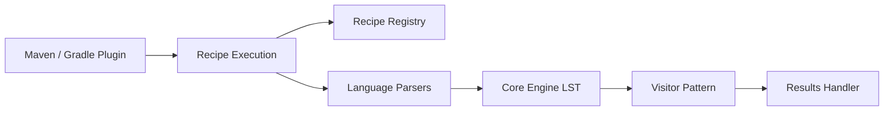

# openrewrite/rewrite

> Moteur de refactoring automatisé du code source, avec recettes, maintenu par Moderne.

## Le problème
Migrer un framework, corriger une faille ou harmoniser le style sur une base de code prend des jours de modifications à la main.

## Ce que ça fait vraiment
Exécute des recettes sur un arbre sémantique sans perte (LST), modèle du code typé construit en mémoire à chaque exécution. Parseurs pour Java, Kotlin, Groovy, JavaScript/TypeScript, Python, C#, plus XML, YAML, Maven, Gradle. Plugins Maven et Gradle lancent une recette sur un dépôt. La plateforme commerciale Moderne exécute sur des milliers de dépôts.

## Comment c'est branché

## Essayer
Aucune commande dans le README : renvoi au guide de démarrage en ligne.

## Coût et pièges
Gratuit pour le cadre ; modèle de licences à niveaux. Les parseurs des langages hors Java sont sous la Moderne Source Available License (gratuits sur ton code) et les recettes propriétaires exigent une licence commerciale.

## Ce que ce n'est pas
Pas une IA : des recettes déterministes. L'exécution multi-dépôts et l'outillage pour agents relèvent du produit payant.

## Alternatives
Aucune alternative nommée dans le README.

## Pour toi
Surveiller : utile pour des migrations de code Java ou Python à grande échelle ; la partie multi-dépôts est payante.

