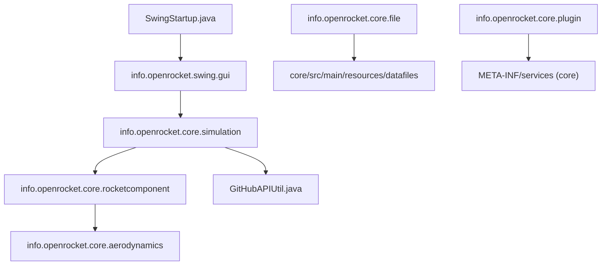

# openrocket/openrocket

> Model rocket simulator, in Java, to design and simulate a flight before building.

## The problem
Sizing a rocket by eye leads to unstable flights; stability, apogee and motor must be simulated before construction.

## What it actually does
Swing application with a core that models components, aerodynamics and six-degree-of-freedom simulation, plus automatic optimization. It imports and exports .ork, RockSim, RASAero, OBJ (3D printing) and SVG (laser cutting) files. Motor and part catalogs are loaded from embedded files; plugins hook in through ServiceLoader.

## How it is wired

## Trying it
No command documented in the README: download an installer from the Releases page, then open one of the built-in example designs.

## Cost and gotchas
Free, Java application. The README says it collects no telemetry; network requests (updates, motor database, bug report) can be turned off in the preferences.

## What it is not
Not a CFD tool: it is a model rocket flight simulator. The license is present but not identified by GitHub.

## Alternatives
No alternative cited; the README lists complementary projects (orhelper to script in Python, RocketSerializer, FreeCAD Rocket Workbench).

## For you
Ignore: outside the data / AI scope; only the orhelper Python integration could be useful for design optimization.
