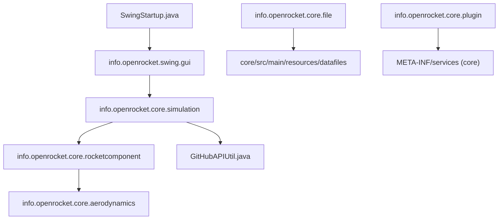

# openrocket/openrocket

> Simulateur de fusées modèles, en Java, pour concevoir et simuler un vol avant de construire.

## Le problème
Dimensionner une fusée à l'œil conduit à des vols instables ; il faut simuler stabilité, apogée et moteur avant la construction.

## Ce que ça fait vraiment
Application Swing avec un noyau (core) qui modélise les composants, l'aérodynamique et la simulation à six degrés de liberté, plus l'optimisation automatique. Elle importe et exporte des fichiers .ork, RockSim, RASAero, OBJ (impression 3D) et SVG (découpe laser). Les catalogues de moteurs et de pièces sont chargés depuis des fichiers embarqués ; des plugins se branchent par ServiceLoader.

## Comment c'est branché

## Essayer
Aucune commande documentée dans le README : télécharger un installeur depuis la page Releases, puis ouvrir un des exemples de conception intégrés.

## Coût et pièges
Gratuit, application Java. Le README dit ne pas collecter de télémétrie ; les requêtes réseau (mises à jour, base de moteurs, rapport de bug) se coupent dans les préférences.

## Ce que ce n'est pas
Pas un outil de CFD : c'est un simulateur de vol de fusée modèle. La licence est présente mais non identifiée par GitHub.

## Alternatives
Aucune alternative citée ; le README liste des projets complémentaires (orhelper pour scripter en Python, RocketSerializer, FreeCAD Rocket Workbench).

## Pour toi
Ignorer : hors périmètre data / IA ; seul l'intégration Python orhelper pourrait servir pour de l'optimisation de conception.

