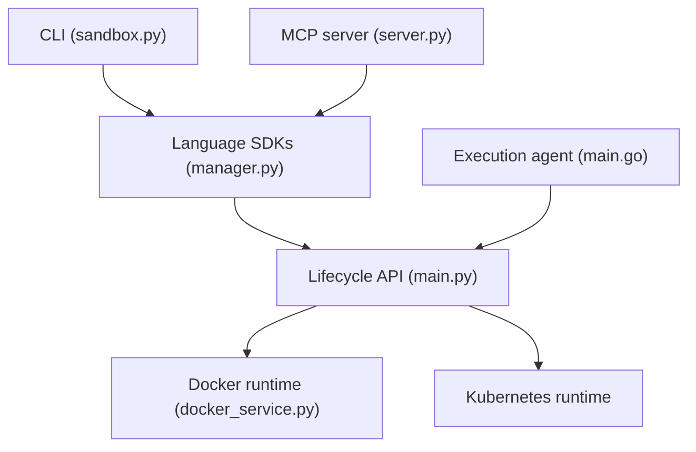

# opensandbox-group/OpenSandbox

> Self-hosted sandbox platform for AI agents to run code, commands and browsers.

## The problem
Letting an agent run generated code on your machine is risky, and hosted sandbox services are expensive and expose your data.

## What it actually does
A unified lifecycle API creates sandboxes, runs commands and manages files. Docker runtime locally, Kubernetes in a cluster (pools, batch creation, Firecracker runtime with pause and resume). Network control via an ingress gateway and per-sandbox egress policies, plus a Credential Vault. SDKs for Python, Java/Kotlin, TypeScript, C#, Go, an `osb` CLI and an MCP server.

## How it is wired


## Trying it
```bash
uvx opensandbox-server init-config ~/.sandbox.toml --example docker
uvx opensandbox-server
uv pip install opensandbox
pip install opensandbox-cli
```

## Cost and gotchas
Docker is required locally, Python 3.10+. The README warns: recent "umbrella" versions have a signature and image provenance mismatch, so pin by digest in production.

## What it is not
Not a desktop tool: it is infrastructure to operate. The advertised Firecracker performance applies to Kubernetes, not to local Docker.

## Alternatives
No alternative named in the README.

## For you
Worth watching: very relevant for running agents or evaluations in isolation, but operating it has a real cost; test it on Docker before considering Kubernetes.
