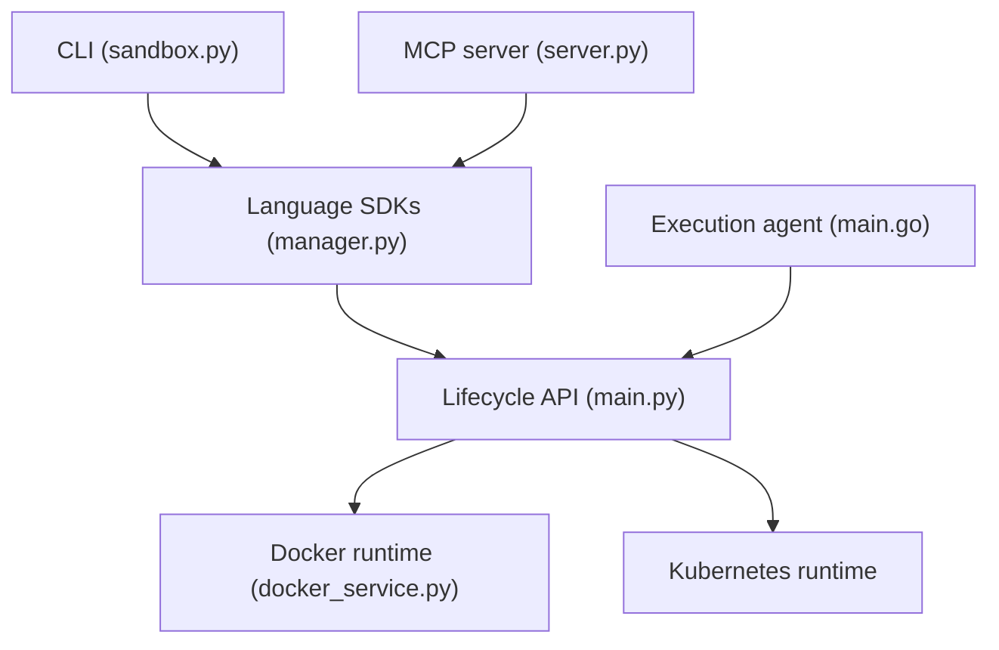

# opensandbox-group/OpenSandbox

> Plateforme auto-hébergée de bacs à sable pour que des agents IA exécutent code, commandes et navigateurs.

## Le problème
Laisser un agent exécuter du code généré sur ta machine est risqué, et les services de sandbox hébergés coûtent cher et exposent tes données.

## Ce que ça fait vraiment
Une API unifiée de cycle de vie crée des sandboxes, exécute des commandes et gère des fichiers. Runtime Docker en local, Kubernetes en cluster (pools, création par lots, runtime Firecracker avec pause et reprise). Contrôle réseau par passerelle d'entrée et politiques de sortie par sandbox, plus un Credential Vault. SDK Python, Java/Kotlin, TypeScript, C#, Go, CLI `osb` et serveur MCP.

## Comment c'est branché


## Essayer
```bash
uvx opensandbox-server init-config ~/.sandbox.toml --example docker
uvx opensandbox-server
uv pip install opensandbox
pip install opensandbox-cli
```

## Coût et pièges
Docker obligatoire en local, Python 3.10+. Le README met en garde : les versions « umbrella » récentes ont un écart de signature et de provenance des images, donc épingle par empreinte (digest) en production.

## Ce que ce n'est pas
Pas un outil de bureau : c'est une infrastructure à opérer. Les performances Firecracker annoncées valent pour Kubernetes, pas pour Docker local.

## Alternatives
Aucune alternative nommée dans le README.

## Pour toi
À surveiller : très pertinent pour exécuter des agents ou des évaluations en isolation, mais l'opérer a un coût réel ; à tester en Docker avant d'envisager Kubernetes.

