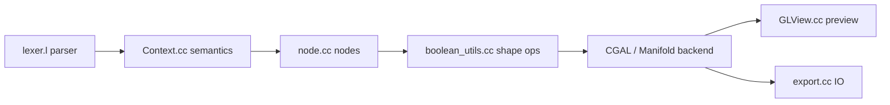

# openscad/openscad

> 3D CAD software that generates solids from a script, for parametric mechanical parts.

## The problem
Modeling parametric parts with a mouse is hard to reproduce; a script can be versioned and parameterized.

## What it actually does
3D compiler: a `.scad` file is parsed, evaluated into a CSG tree, converted to geometry (CGAL and Manifold backends), previewed (OpenCSG) or exported (STL, OFF, 3MF, SVG, DXF…). Qt interface, command-line interface, Python API, WebAssembly build.

## How it is wired


## Trying it
```bash
git clone https://github.com/openscad/openscad.git
cd openscad
git submodule update --init --recursive
cmake -B build -DEXPERIMENTAL=1
cmake --build build
```

## Cost and gotchas
Free. Building requires many dependencies (Qt, CGAL, boost, OpenCSG…); the Windows target is cross-compiled and can take hours.

## What it is not
Not an interactive modeler nor an artistic tool like Blender. License "unidentified" in the catalog.

## Alternatives
Blender is mentioned, for the artistic side rather than CAD.

## For you
Ignore: mechanical CAD is outside your data/AI/MLOps needs.
