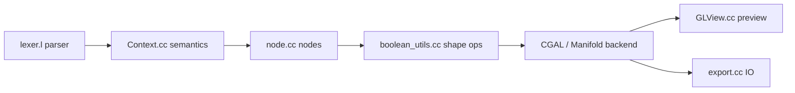

# openscad/openscad

> Logiciel de CAO 3D qui génère des solides à partir d'un script, pour pièces mécaniques paramétriques.

## Le problème
Modéliser des pièces paramétrables à la souris est peu reproductible ; un script se versionne et se paramètre.

## Ce que ça fait vraiment
Compilateur 3D : un fichier `.scad` est analysé, évalué en arbre CSG, converti en géométrie (backends CGAL et Manifold), prévisualisé (OpenCSG) ou exporté (STL, OFF, 3MF, SVG, DXF…). Interface Qt, interface en ligne de commande, API Python, build WebAssembly.

## Comment c'est branché


## Essayer
```bash
git clone https://github.com/openscad/openscad.git
cd openscad
git submodule update --init --recursive
cmake -B build -DEXPERIMENTAL=1
cmake --build build
```

## Coût et pièges
Gratuit. La compilation demande de nombreuses dépendances (Qt, CGAL, boost, OpenCSG…) ; la cible Windows se cross-compile et peut prendre des heures.

## Ce que ce n'est pas
Pas un modeleur interactif ni un outil artistique comme Blender. Licence « non identifiée » au catalogue.

## Alternatives
Blender est cité, pour l'aspect artistique plutôt que CAO.

## Pour toi
À ignorer : CAO mécanique hors de tes besoins data/IA/MLOps.

