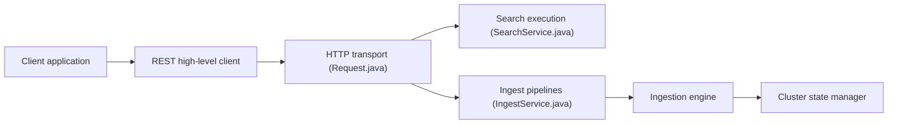

# opensearch-project/OpenSearch

> Open source distributed search and observability engine, for those who index large volumes of unstructured data.

## The problem
Searching and analyzing logs, documents and metrics at scale, without depending on an Elasticsearch license.

## What it actually does
A client sends queries through the REST client and the HTTP transport to a cluster. The search service executes the queries, with optional search pipelines. Indexing can go through ingest pipelines before the shard engines. There is also streaming ingestion, a PPL query service and Azure and GCS snapshot repositories. The very short README details nothing more.

## How it is wired

## Trying it
The README contains no command. No documented command; see the website and the downloads.

## Cost and gotchas
Free, but a cluster requires memory and operations work. 3,286 open issues. The README does not explain installation.

## What it is not
Not a transactional database. It reuses Apache-licensed code from Elasticsearch, but ELASTICSEARCH remains a trademark of Elasticsearch B.V.

## Alternatives
No alternative named in the README.

## For you
Adopt it for hybrid RAG, logs or vector search: Apache-2.0, governed by the Linux Foundation, so no license risk.
