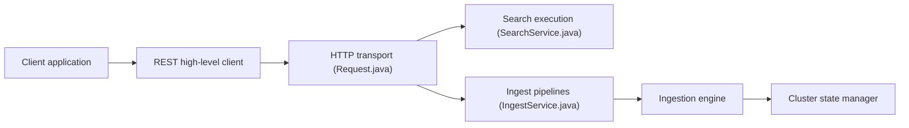

# opensearch-project/OpenSearch

> Moteur distribué de recherche et d'observabilité open source, pour qui indexe de gros volumes de données non structurées.

## Le problème
Chercher et analyser des logs, documents et métriques à grande échelle, sans dépendre d'une licence Elasticsearch.

## Ce que ça fait vraiment
Un client envoie des requêtes via le client REST et le transport HTTP vers un cluster. Le service de recherche exécute les requêtes, avec des pipelines de recherche optionnels. L'indexation peut passer par des pipelines d'ingestion avant les moteurs de shards. Il existe aussi une ingestion en flux, un service de requêtes PPL et des dépôts de snapshots Azure et GCS. Le README, très court, ne détaille rien de plus.

## Comment c'est branché

## Essayer
Le README ne contient aucune commande. Aucune commande documentée ; voir le site et les téléchargements.

## Coût et pièges
Gratuit, mais un cluster demande de la mémoire et de l'exploitation. 3 286 issues ouvertes. Le README n'explique pas l'installation.

## Ce que ce n'est pas
Pas une base transactionnelle. Il reprend du code Apache d'Elasticsearch, mais ELASTICSEARCH reste une marque d'Elasticsearch B.V.

## Alternatives
Aucune alternative nommée dans le README.

## Pour toi
À adopter pour du RAG hybride, des logs ou de la recherche vectorielle : Apache-2.0, gouverné par la Linux Foundation, donc sans risque de licence.

