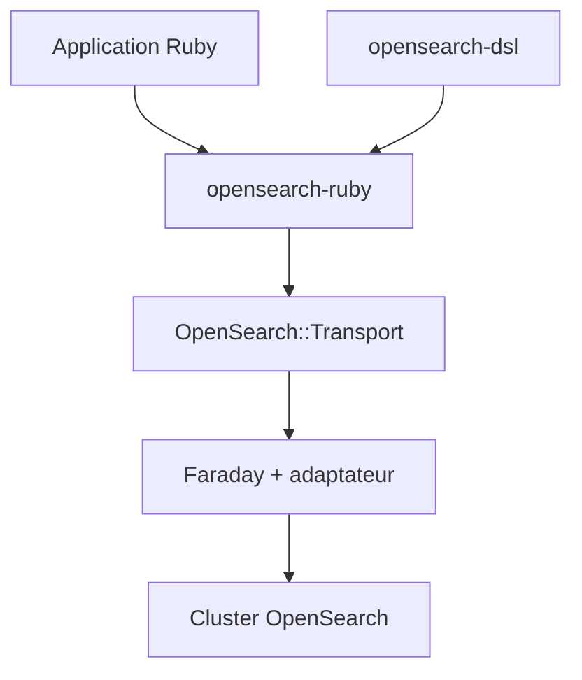

# opensearch-project/opensearch-ruby

> Official Ruby client for OpenSearch, for Ruby developers who query a cluster.

## The problem
Talking to OpenSearch from Ruby requires a robust HTTP transport and a way to write queries.

## What it actually does
Community fork of elasticsearch-ruby. The `OpenSearch::Transport` layer offers logging, connection selection strategies, retries, node reloading and a pluggable serializer, via Faraday. `opensearch-dsl` builds queries (filters, aggregations, suggestions, sorting, pagination).

## How it is wired
Simplified diagram based on the sheet, no diagram provided.



## Trying it
```bash
# aucune commande dans le README : voir USER_GUIDE
```

## Cost and gotchas
Free, but requires an OpenSearch cluster. Ruby is not in the list of prerequisites: a Ruby environment is needed.

## What it is not
Not a search engine: only a client. Performance depends on an HTTP library with persistent connections.

## Alternatives
No alternative named in the README.

## For you
Ignore: for OpenSearch usage in Python, a Ruby client is of no use to you.
