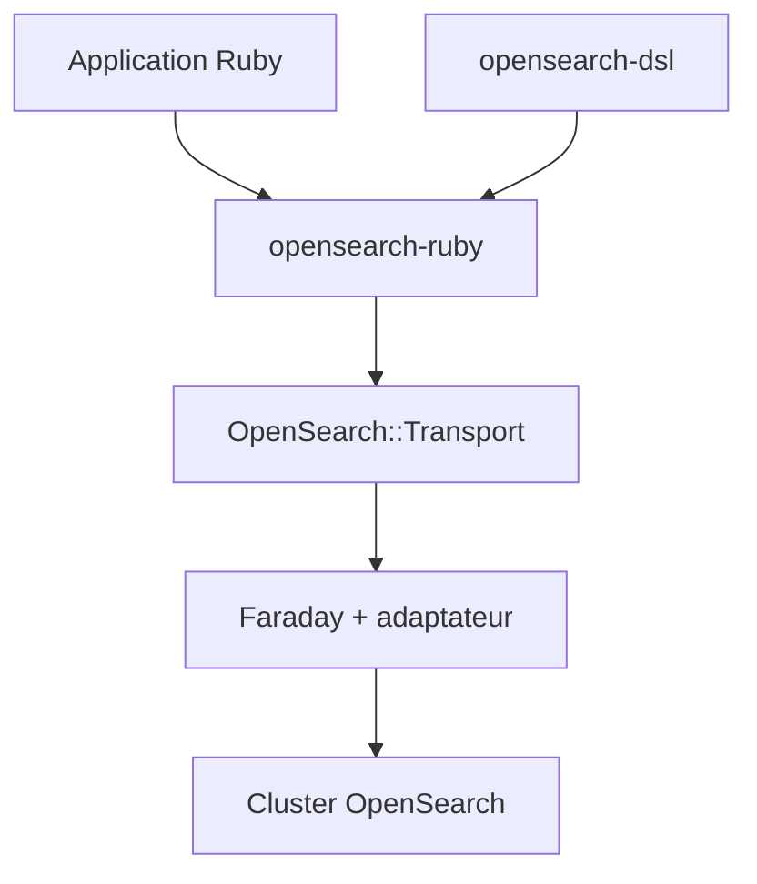

# opensearch-project/opensearch-ruby

> Client Ruby officiel pour OpenSearch, pour développeurs Ruby qui interrogent un cluster.

## Le problème
Parler à OpenSearch depuis Ruby demande un transport HTTP robuste et un moyen d'écrire les requêtes.

## Ce que ça fait vraiment
Fork communautaire d'elasticsearch-ruby. La couche `OpenSearch::Transport` offre journalisation, stratégies de sélection de connexion, nouvelles tentatives, rechargement des nœuds et sérialiseur enfichable, via Faraday. `opensearch-dsl` construit des requêtes (filtres, agrégations, suggestions, tri, pagination).

## Comment c'est branché
Schéma simplifié d'après la fiche, sans diagramme fourni.



## Essayer
```bash
# aucune commande dans le README : voir USER_GUIDE
```

## Coût et pièges
Gratuit, mais exige un cluster OpenSearch. Ruby n'est pas dans la liste des prérequis : il faut un environnement Ruby.

## Ce que ce n'est pas
Pas un moteur de recherche : seulement un client. Les performances dépendent d'une bibliothèque HTTP à connexions persistantes.

## Alternatives
Aucune alternative nommée dans le README.

## Pour toi
Ignorer : pour l'usage OpenSearch en Python, un client Ruby ne te sert pas.

