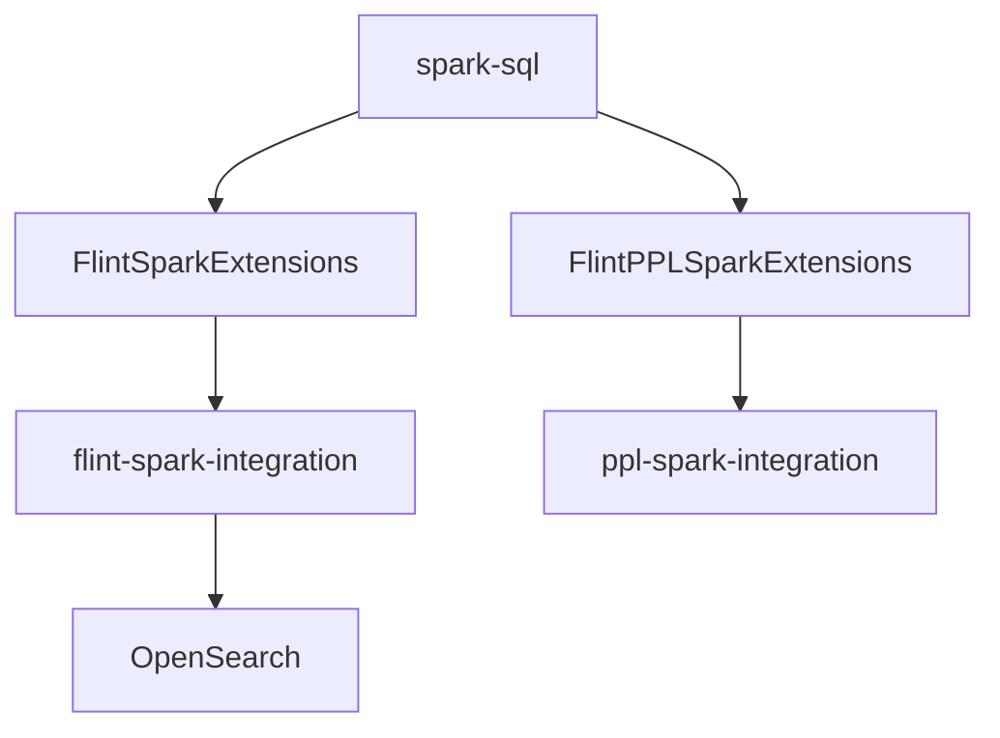

# opensearch-project/opensearch-spark

> Spark extension for OpenSearch: Flint indexes and PPL query execution on Spark.

## The problem
Connecting Spark and OpenSearch requires a dedicated client and a common query language.

## What it actually does
Four modules: `flint-core`, `flint-commons`, `flint-spark-integration` and `ppl-spark-integration`. The Spark extensions add Flint indexes and PPL-to-Spark translation. A table gives JDK, Spark, Scala and OpenSearch compatibility by version.

## How it is wired


## Trying it
```bash
spark-sql --conf "spark.sql.extensions=org.opensearch.flint.spark.FlintSparkExtensions"
sbt clean standaloneCosmetic/publishM2
sbt clean sparkPPLCosmetic/publishM2
```

## Cost and gotchas
Free; JDK 11 and Spark 3.5.1 for recent versions, an OpenSearch cluster to provide. The target version is a SNAPSHOT you must build yourself.

## What it is not
Not a search engine: an integration layer. No ready-to-use package, the build is indicated.

## Alternatives
No alternative named in the README.

## For you
Worth watching if your data goes through Spark and OpenSearch; otherwise the build effort is not worth it.
