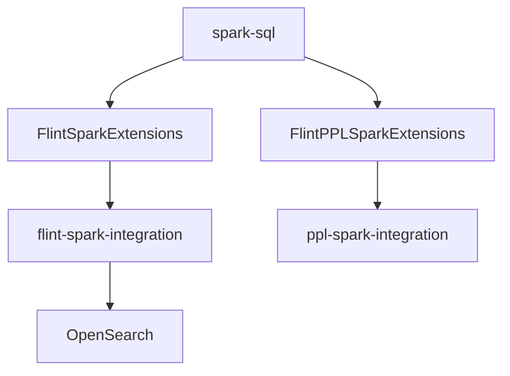

# opensearch-project/opensearch-spark

> Extension Spark pour OpenSearch : index Flint et exécution de requêtes PPL sur Spark.

## Le problème
Relier Spark et OpenSearch demande un client dédié et un langage de requête commun.

## Ce que ça fait vraiment
Quatre modules : `flint-core`, `flint-commons`, `flint-spark-integration` et `ppl-spark-integration`. Les extensions Spark ajoutent les index Flint et la traduction PPL vers Spark. Un tableau donne la compatibilité JDK, Spark, Scala et OpenSearch selon la version.

## Comment c'est branché


## Essayer
```bash
spark-sql --conf "spark.sql.extensions=org.opensearch.flint.spark.FlintSparkExtensions"
sbt clean standaloneCosmetic/publishM2
sbt clean sparkPPLCosmetic/publishM2
```

## Coût et pièges
Gratuit ; JDK 11 et Spark 3.5.1 pour les versions récentes, un cluster OpenSearch à fournir. La version cible est un SNAPSHOT à compiler soi-même.

## Ce que ce n'est pas
Pas un moteur de recherche : une couche d'intégration. Pas de paquet prêt à l'emploi, la compilation est indiquée.

## Alternatives
Aucune alternative nommée dans le README.

## Pour toi
À surveiller si tes données passent par Spark et OpenSearch ; sinon l'effort de compilation n'en vaut pas la peine.

