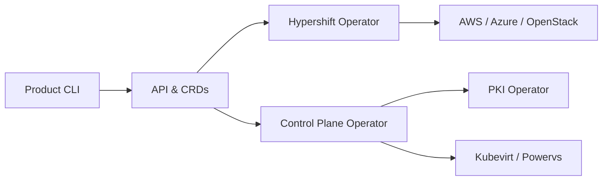

# openshift/hypershift

> Middleware that hosts OpenShift control planes at scale, for platform teams.

## The problem
One OpenShift control plane per cluster is expensive and slow to provision. Separating management from workloads is hard.

## What it actually does
The README is only a few lines long: it announces hosted control planes, portable across clouds, and clusters compatible with OCP and Kubernetes. The detail comes from the architecture: CRDs drive operators (control-plane-operator, hypershift-operator, PKI, karpenter) that provision on AWS, Azure, OpenStack, PowerVS, Kubevirt. The rest is deferred to the documentation.

## How it is wired


## Trying it
```bash
# Aucune commande documentée dans le README : voir la documentation en ligne.
```

## Cost and gotchas
Assumes a Kubernetes/OpenShift management cluster and cloud accounts. Cloud bill at your expense; the README gives no figures.

## What it is not
Not a tool for an isolated data/AI use: it is platform infrastructure. README too short to assess installation or limits.

## Alternatives
No alternative named in the README.

## For you
Ignore: it is multi-tenant OpenShift plumbing, outside the usual data/MLOps scope, and the README gives nothing to test.
