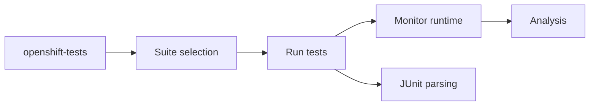

# openshift/origin

> Red Hat repository that maintains the `openshift-tests` (e2e) test binary for OpenShift/OKD clusters.

## The problem
Validating that an OpenShift cluster behaves correctly requires a battery of e2e tests and disruption tracking. This repository brings them together.

## What it actually does
Since the 4.6+ branches, it no longer produces `hyperkube` (moved to `openshift/kubernetes`): it only maintains `openshift-tests`. The binary selects suites, runs them, and monitors record the cluster's behavior. It also contains alert analysis, e2e risk analysis and a JUnit parser.

## How it is wired


## Trying it
```bash
make
hack/update-kube-vendor.sh <openshift/kubernetes branch name or SHA>
```
To run a specific suite: read `test/extended/README`.

## Cost and gotchas
You need an OpenShift cluster to test; vendoring from `openshift/kubernetes` is temporary and can fail with "410 Gone" (workaround `GOSUMDB=off`).

## What it is not
It is no longer the Kubernetes repository for OKD nor for `hyperkube`. It is not a tool usable without an OpenShift cluster.

## Alternatives
No alternative named in the README.

## For you
Ignore in data/MLOps unless you operate or qualify OpenShift clusters: it is internal platform test tooling.
