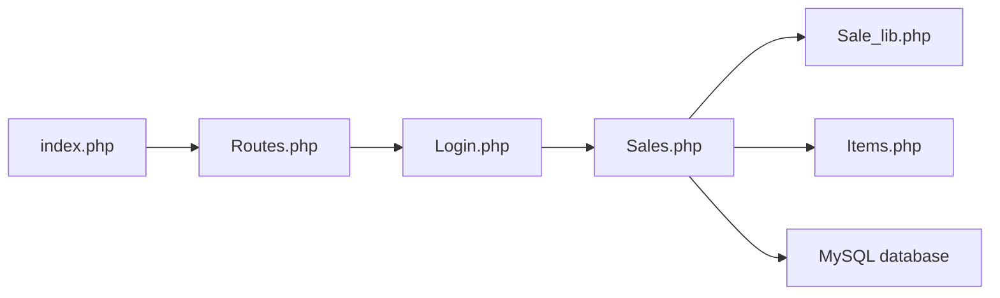

# opensourcepos/opensourcepos

> PHP/MySQL web point of sale for shops, restaurants and small stores.

## The problem
Manage a business's stock, sales, invoicing and till without proprietary software.

## What it actually does
CodeIgniter 4 application: stock (items, kits), point of sale with a transaction log, quotes/invoices, expenses, cash closing, customers/suppliers, reports, multi-user with permissions, gift cards, restaurant tables, SMS, MailChimp, optional reCAPTCHA. PHP 8.2 minimum.

## How it is wired

## Trying it
No command documented in the README: see INSTALL.md (online demo with published test credentials).

## Cost and gotchas
Free; PHP 8.2+ web server and MySQL/MariaDB. Installations not described in INSTALL.md are not supported. License not identified by GitHub.

## What it is not
Not a full ERP; no support for atypical installations.

## Alternatives
No alternative named in the README.

## For you
Ignore: PHP point-of-sale software, outside the data/AI scope.
