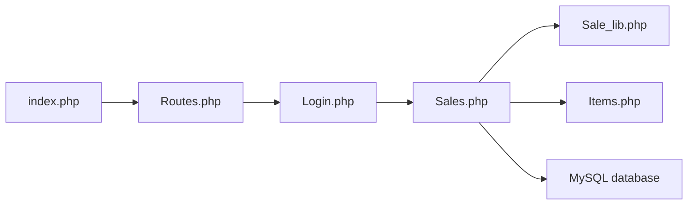

# opensourcepos/opensourcepos

> Caisse enregistreuse web en PHP/MySQL pour commerces, restaurants et petites boutiques.

## Le problème
Tenir stock, ventes, facturation et caisse d'un commerce sans logiciel propriétaire.

## Ce que ça fait vraiment
Application CodeIgniter 4 : stock (articles, kits), caisse avec journal de transactions, devis/factures, dépenses, clôture de caisse, clients/fournisseurs, rapports, multi-utilisateurs avec permissions, cartes cadeaux, tables de restaurant, SMS, MailChimp, reCAPTCHA optionnel. PHP 8.2 minimum.

## Comment c'est branché

## Essayer
Aucune commande documentée dans le README : voir INSTALL.md (démo en ligne avec identifiants de test publiés).

## Coût et pièges
Gratuit ; serveur web PHP 8.2+ et MySQL/MariaDB. Les installations non décrites dans INSTALL.md ne sont pas supportées. Licence non identifiée par GitHub.

## Ce que ce n'est pas
Pas un ERP complet ; pas de support pour les installations atypiques.

## Alternatives
Aucune alternative nommée dans le README.

## Pour toi
À ignorer : logiciel de caisse PHP, hors périmètre data/IA.

