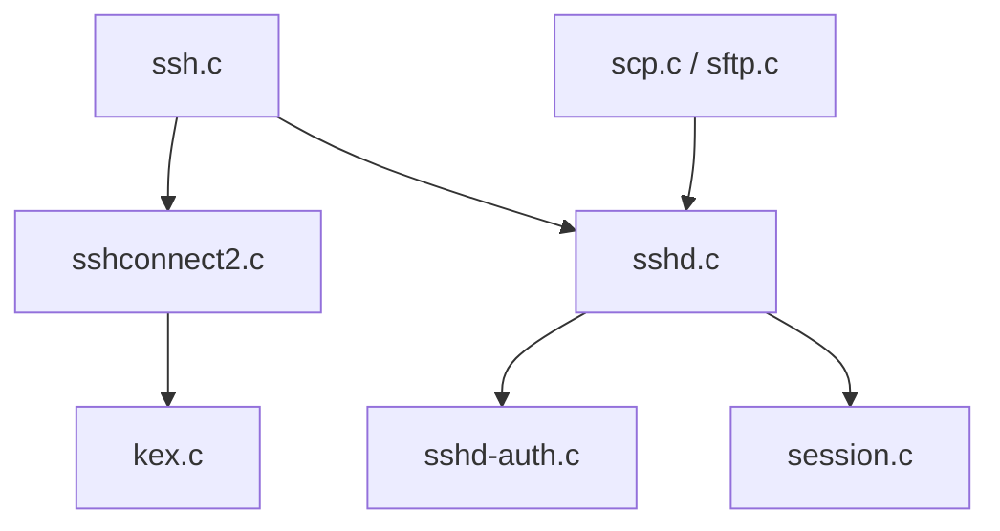

# openssh/openssh-portable

> A port of OpenSSH to Unix systems: client, server, file copy and key management.

## The problem
Connecting remotely, running commands and transferring files over an encrypted channel on a wide variety of systems.

## What it actually does
It provides `ssh`, `sshd`, `scp`, `sftp`, `ssh-keygen`, `ssh-agent`, `ssh-keyscan` and `sftp-server`. The port adds compatibility shims for OpenBSD APIs missing elsewhere, sshd isolation on more systems, and support for PAM and auditing. Algorithms depend on libcrypto (LibreSSL, OpenSSL, AWS-LC or BoringSSL) if present.

## How it is wired


## Trying it
```bash
git clone https://github.com/openssh/openssh-portable
cd openssh-portable
autoreconf
./configure
make && make tests
```

## Cost and gotchas
Free. You need autoconf to build from git, or a release archive that bundles `configure`. Without libcrypto, some algorithms are missing. The license is present but not identified by GitHub.

## What it is not
Not a tool to build yourself for everyday use: the README recommends a stable distribution release.

## Alternatives
No alternative named in the README.

## For you
Ignore as a repo to follow: you already use it through your distribution; build it only for a specific need.
