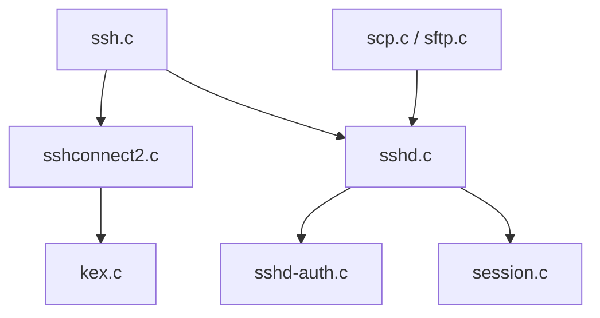

# openssh/openssh-portable

> Portage d'OpenSSH vers les systèmes Unix : client, serveur, copie de fichiers et gestion de clés.

## Le problème
Se connecter à distance, exécuter des commandes et transférer des fichiers de façon chiffrée sur des systèmes variés.

## Ce que ça fait vraiment
Il fournit `ssh`, `sshd`, `scp`, `sftp`, `ssh-keygen`, `ssh-agent`, `ssh-keyscan` et `sftp-server`. Le portage ajoute des compléments pour les API d'OpenBSD absentes ailleurs, l'isolation de sshd sur plus de systèmes, et la prise en charge de PAM et de l'audit. Les algorithmes dépendent de libcrypto (LibreSSL, OpenSSL, AWS-LC ou BoringSSL) si présente.

## Comment c'est branché


## Essayer
```bash
git clone https://github.com/openssh/openssh-portable
cd openssh-portable
autoreconf
./configure
make && make tests
```

## Coût et pièges
Gratuit. Il faut autoconf pour compiler depuis git, ou une archive de version qui embarque `configure`. Sans libcrypto, il manque des algorithmes. La licence est présente mais non identifiée par GitHub.

## Ce que ce n'est pas
Ce n'est pas un outil à compiler soi-même pour un usage courant : le README recommande une version stable de distribution.

## Alternatives
Aucune alternative nommée dans le README.

## Pour toi
À ignorer comme dépôt à suivre : tu l'utilises déjà via ta distribution, ne compile que pour un besoin précis.

