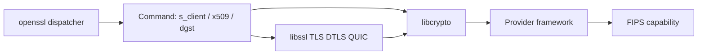

# openssl/openssl

> Toolkit for TLS, DTLS, QUIC and general-purpose cryptography, with a FIPS module, for any systems developer.

## The problem
Encrypting communications and managing certificates, keys and signatures requires a reliable, audited cryptographic library.

## What it actually does
Three components: `libssl` (TLS up to 1.3, DTLS up to 1.3, QUIC v1), `libcrypto` (general cryptography, usable on its own) and the `openssl` command (keys, X.509 certificates, CSR, CRL, fingerprints, encryption, client/server tests, S/MIME). Provider-based architecture, including a FIPS-validated module. The code also shows CMS, CMP and OCSP.

## How it is wired


## Trying it
```bash
git clone https://github.com/openssl/openssl.git
```
For building: the repository's INSTALL file.

## Cost and gotchas
Free. The GitHub repository is only a mirror; binaries are not distributed by the project: use your distribution's packages. Legal restrictions on cryptography exist in some countries.

## What it is not
Not an application nor a complete PKI management tool. The 3.x versions have API changes: see the migration guide.

## Alternatives
No alternative mentioned in the README.

## For you
Ignore directly: you already use it through the system and Python; only build it for a specific need (FIPS, a specific version).
