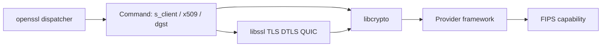

# openssl/openssl

> Boîte à outils de TLS, DTLS, QUIC et de cryptographie générale, avec module FIPS, pour tout développeur système.

## Le problème
Chiffrer les communications et gérer certificats, clés et signatures demande une bibliothèque cryptographique fiable et auditée.

## Ce que ça fait vraiment
Trois composants : `libssl` (TLS jusqu'à 1.3, DTLS jusqu'à 1.3, QUIC v1), `libcrypto` (cryptographie générale, utilisable seule) et la commande `openssl` (clés, certificats X.509, CSR, CRL, empreintes, chiffrement, tests clients/serveurs, S/MIME). Architecture à fournisseurs (providers) dont un module validé FIPS. Le code montre aussi CMS, CMP et OCSP.

## Comment c'est branché


## Essayer
```bash
git clone https://github.com/openssl/openssl.git
```
Pour la compilation : le fichier INSTALL du dépôt.

## Coût et pièges
Gratuit. Le dépôt GitHub n'est qu'un miroir ; les binaires ne sont pas distribués par le projet : on utilise les paquets de sa distribution. Des restrictions légales existent sur la cryptographie dans certains pays.

## Ce que ce n'est pas
Pas une application ni un outil de gestion de PKI complet. Les versions 3.x ont des changements d'API : voir le guide de migration.

## Alternatives
Aucune alternative citée dans le README.

## Pour toi
À ignorer en direct : tu l'utilises déjà via le système et Python ; ne le compiler que pour un besoin précis (FIPS, version spécifique).

