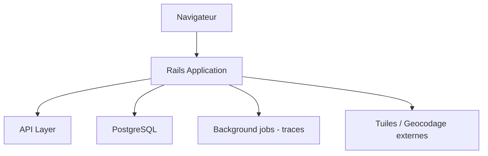

# openstreetmap/openstreetmap-website

> Ruby on Rails application that runs the OpenStreetMap website and API.

## The problem
OpenStreetMap needs a website, accounts and an editing API for millions of contributors.

## What it actually does
Accounts, diaries, messaging, XML/JSON editing API, pages for browsing the data, upload and viewing of GPX traces. Rails on PostgreSQL; asynchronous jobs for importing/deleting traces; embedded iD editor. A full installation depends on third-party tile and geocoding servers, which the default installation replaces with public services.

## How it is wired

## Trying it
No command in the README; it points to INSTALL.md.

## Cost and gotchas
Free; many dependencies and third-party services to install. 669 open issues.

## What it is not
Not a map rendering engine nor a dataset: it is the website.

## Alternatives
No alternative named in the README.

## For you
Ignore, unless you want to understand the architecture of a large Rails site; outside the direct data/AI scope.
