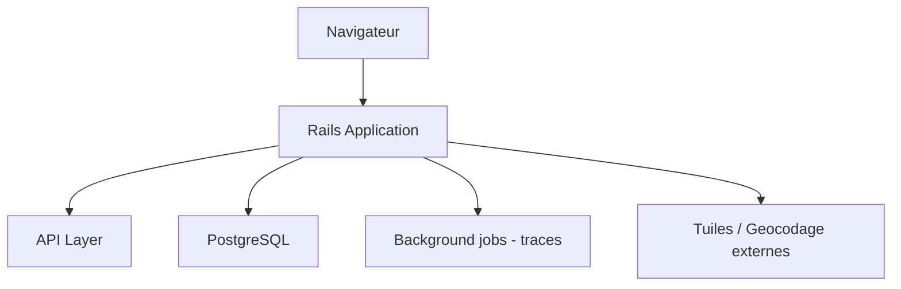

# openstreetmap/openstreetmap-website

> Application Ruby on Rails qui fait tourner le site et l'API d'OpenStreetMap.

## Le problème
OpenStreetMap a besoin d'un site web, de comptes et d'une API d'édition pour des millions de contributeurs.

## Ce que ça fait vraiment
Comptes, journaux, messagerie, API d'édition XML/JSON, pages de navigation sur les données, envoi et consultation de traces GPX. Rails sur PostgreSQL ; tâches asynchrones d'import/destruction de traces ; éditeur iD intégré. Une installation complète dépend de serveurs de tuiles et de géocodage tiers, que l'installation par défaut remplace par des services publics.

## Comment c'est branché

## Essayer
Aucune commande dans le README ; il renvoie à INSTALL.md.

## Coût et pièges
Gratuit ; nombreuses dépendances et services tiers à installer. 669 issues ouvertes.

## Ce que ce n'est pas
Pas un moteur de rendu de cartes ni un jeu de données : c'est le site web.

## Alternatives
Aucune alternative nommée dans le README.

## Pour toi
À ignorer, sauf si tu veux comprendre l'architecture d'un grand site Rails ; hors périmètre data/IA direct.

