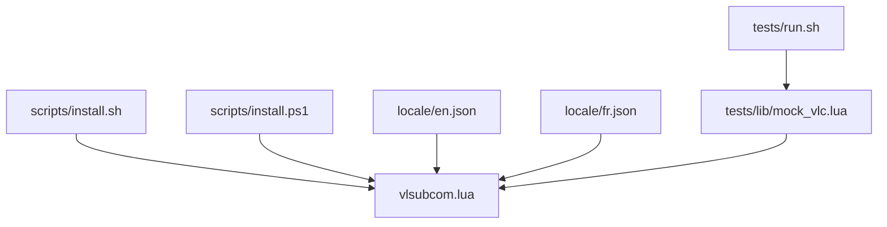

# opensubtitles/vlsub-opensubtitles-com

> VLC extension to download subtitles from OpenSubtitles.com via its REST API.

## The problem
Manually searching for and loading synchronized subtitles in VLC.

## What it actually does
A single Lua file, `vlsubcom.lua`, searches by file hash or by name (GuessIt), with up to three languages and quality indicators. It updates itself, and the translations are in `locale/`. A free OpenSubtitles.com account is required, with a download quota.

## How it is wired
Diagram based on the code.



## Trying it
```bash
curl -sSL https://raw.githubusercontent.com/opensubtitles/vlsub-opensubtitles-com/main/scripts/install.sh | bash
paru -S vlsub-opensubtitles-com-git
```

## Cost and gotchas
Free, but an OpenSubtitles.com account and VLC 3.0+ are required. The `curl | bash` installation should be reviewed before running. Daily quotas apply.

## What it is not
Not for OpenSubtitles.org (the old vlsub version). Credentials are entered in the extension.

## Alternatives
- `vlsub` (.org version): old XML-RPC API, account optional.

## For you
Ignore: personal convenience for VLC, unrelated to data / AI / MLOps work.
