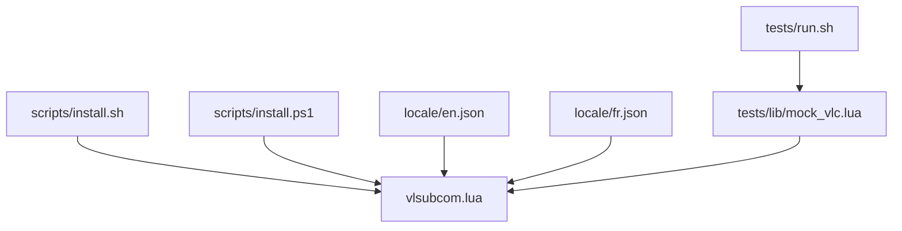

# opensubtitles/vlsub-opensubtitles-com

> Extension VLC pour télécharger des sous-titres depuis OpenSubtitles.com via son API REST.

## Le problème
Chercher et charger à la main des sous-titres synchronisés dans VLC.

## Ce que ça fait vraiment
Un seul fichier Lua, `vlsubcom.lua`, cherche par empreinte du fichier ou par nom (GuessIt), avec jusqu'à trois langues et des indicateurs de qualité. Il se met à jour tout seul, et les traductions sont dans `locale/`. Compte gratuit OpenSubtitles.com requis, avec quota de téléchargements.

## Comment c'est branché
Schéma d'après le diagramme du code.



## Essayer
```bash
curl -sSL https://raw.githubusercontent.com/opensubtitles/vlsub-opensubtitles-com/main/scripts/install.sh | bash
paru -S vlsub-opensubtitles-com-git
```

## Coût et pièges
Gratuit, mais il faut un compte OpenSubtitles.com et VLC 3.0+. L'installation par `curl | bash` est à relire avant exécution. Les quotas quotidiens s'appliquent.

## Ce que ce n'est pas
Pas pour OpenSubtitles.org (ancienne version vlsub). Les identifiants sont saisis dans l'extension.

## Alternatives
- `vlsub` (version .org) : ancienne API XML-RPC, compte facultatif.

## Pour toi
Ignorer : confort personnel pour VLC, sans lien avec le travail data / IA / MLOps.

