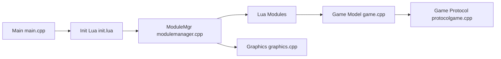

# opentibiabr/otclient

> Alternative C++ and Lua client for playing Tibia on OTServ servers.

## The problem
Private Tibia servers need a free, extensible client compatible with several protocol versions.

## What it actually does
A native C++20 engine (OpenGL rendering, sound, network, widgets, Lua binding) loads modules written in Lua and described in OTUI/OTML. It handles clients 7.6 to 15.24, multiple threads, asynchronous texture loading, effects, shaders and Android and browser support. It is a client only: a server such as theforgottenserver or canary is required.

## How it is wired


## Trying it
```bash
docker build -t mehah/otclient .
```
The full build is described in the wiki, which is not included.

## Cost and gotchas
Free. The build goes through CMake and vcpkg. Settings to know about for old protocols (`force-new-walking-formula` in `data/setup.otml`). The license is present but not identified by GitHub.

## What it is not
Not a game server. Derived from edubart/otclient.

## Alternatives
The README names no alternative.

## For you
Ignore: a game client with no link to data, AI or MLOps.
