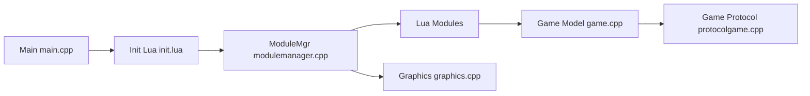

# opentibiabr/otclient

> Client alternatif en C++ et Lua pour jouer à Tibia sur des serveurs OTServ.

## Le problème
Les serveurs privés Tibia ont besoin d'un client libre, extensible et compatible avec plusieurs versions du protocole.

## Ce que ça fait vraiment
Un moteur natif C++20 (rendu OpenGL, son, réseau, widgets, liaison Lua) charge des modules écrits en Lua et décrits en OTUI/OTML. Il gère les clients 7.6 à 15.24, plusieurs threads, un chargement asynchrone des textures, des effets, des shaders et un support Android et navigateur. C'est un client uniquement : un serveur comme theforgottenserver ou canary est nécessaire.

## Comment c'est branché


## Essayer
```bash
docker build -t mehah/otclient .
```
La compilation complète est décrite dans le wiki, non inclus.

## Coût et pièges
Gratuit. La compilation passe par CMake et vcpkg. Réglages à connaître pour les protocoles anciens (`force-new-walking-formula` dans `data/setup.otml`). La licence est présente mais non identifiée par GitHub.

## Ce que ce n'est pas
Pas un serveur de jeu. Dérivé de edubart/otclient.

## Alternatives
Le README ne nomme pas d'alternative.

## Pour toi
Ignorer : client de jeu sans lien avec la data, l'IA ou le MLOps.

