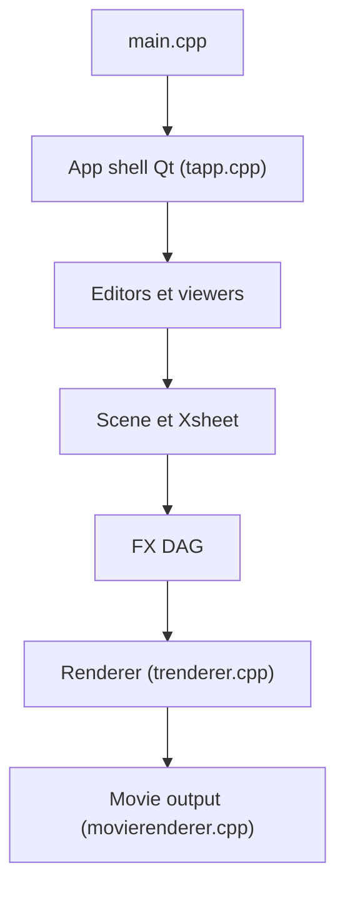

# opentoonz/opentoonz

> 2D animation software published by DWANGO, derived from the Studio Ghibli version of Toonz.

## The problem
Produce studio-grade 2D animation without proprietary software.

## What it actually does
The central model is a scene with levels, columns, cells, palettes and an exposure sheet (Xsheet). Vector and raster drawing tools, cleanup and vectorization modify this model; an effects graph (FX DAG) is rendered in tiles with a cache. A TCP render farm and plugins are available.

## How it is wired


## Trying it
```bash
# Aucune commande dans le README : télécharger l'installateur
# officiel sur opentoonz.github.io (source officielle indiquée).
```

## Cost and gotchas
Free. The README warns to download only from the official site and this repository. The license is present but not identified by GitHub; files outside thirdparty are described as under a modified BSD.

## What it is not
It is not an AI animation tool: it is manual drawing and animation software.

## Alternatives
No alternative named in the README.

## For you
Ignore: animation software unrelated to a data/AI/MLOps profile.
