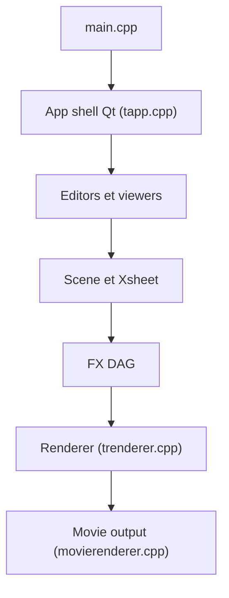

# opentoonz/opentoonz

> Logiciel d'animation 2D publié par DWANGO, issu de la version Studio Ghibli de Toonz.

## Le problème
Produire de l'animation 2D de studio sans logiciel propriétaire.

## Ce que ça fait vraiment
Le modèle central est une scène avec niveaux, colonnes, cellules, palettes et feuille d'exposition (Xsheet). Des outils de dessin vecteur et raster, le nettoyage et la vectorisation modifient ce modèle ; un graphe d'effets (FX DAG) est rendu en tuiles avec cache. Une ferme de rendu TCP et des plugins sont disponibles.

## Comment c'est branché


## Essayer
```bash
# Aucune commande dans le README : télécharger l'installateur
# officiel sur opentoonz.github.io (source officielle indiquée).
```

## Coût et pièges
Gratuit. Le README avertit de ne télécharger que depuis le site officiel et ce dépôt. La licence est présente mais non identifiée par GitHub ; les fichiers hors thirdparty sont décrits comme sous BSD modifiée.

## Ce que ce n'est pas
Ce n'est pas un outil d'animation par IA : c'est un logiciel de dessin et d'animation manuel.

## Alternatives
Aucune alternative nommée dans le README.

## Pour toi
À ignorer : logiciel d'animation sans rapport avec un profil data/IA/MLOps.

