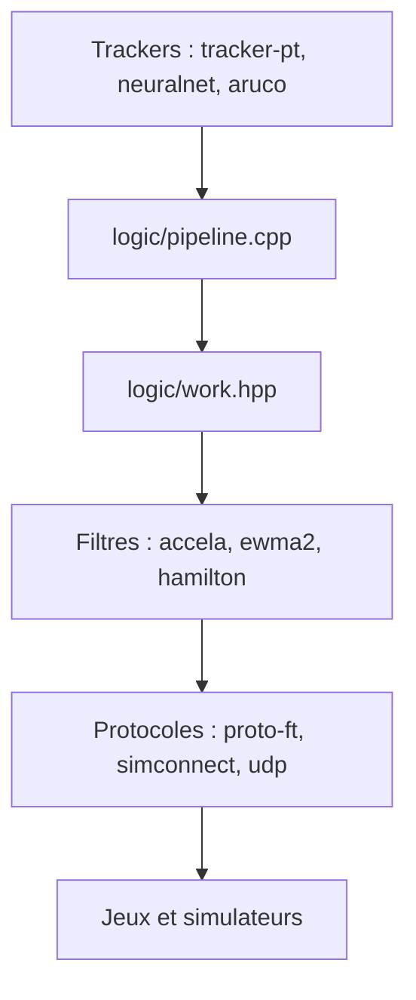

# opentrack/opentrack

> Head rotation tracking, relayed to flight simulators and games.

## The problem
Looking around in a flight simulator without a dedicated controller.

## What it actually does
opentrack reads head position through various sensors (FreeTrack light points, Aruco marker, neural network with webcam, Oculus, Tobii, Wiimote, UDP…), applies filters (Accela, EWMA, Hamilton) then sends the result to games (SimConnect, FreeTrack, FlightGear, UDP, virtual joystick, FSUIPC, X-Plane plugin). It runs on Windows, Linux and macOS (unmaintained).

## How it is wired

## Trying it
The README gives no command: download the `.exe` installer or the `.7z` archive from the releases. To build: see the Visual C++ 2015 instructions, the Linux wiki or `docs/macos-build.md`.

## Cost and gotchas
Free. No license declared in the catalog. Portable installers exist for Windows only. More than 570 open issues. The name clashes with another piece of railway planning software.

## What it is not
It is not a general-purpose computer vision tool, even though it embeds a neural tracker. It targets games and simulators.

## Alternatives
No alternative named in the README, which cites FaceTrackNoIR as its starting code.

## For you
Ignore: it serves simulator gamers; the neural-network pose tracking component is not reusable on its own in your daily MLOps work.
