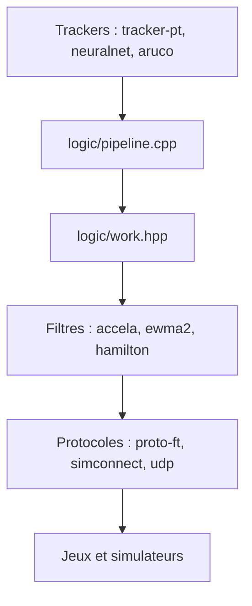

# opentrack/opentrack

> Suivi de la rotation de la tête, relayé vers des simulateurs de vol et des jeux.

## Le problème
Regarder autour de soi dans un simulateur de vol sans manette dédiée.

## Ce que ça fait vraiment
opentrack lit la position de la tête via divers capteurs (points lumineux FreeTrack, marqueur Aruco, réseau de neurones avec webcam, Oculus, Tobii, Wiimote, UDP…), applique des filtres (Accela, EWMA, Hamilton) puis envoie le résultat aux jeux (SimConnect, FreeTrack, FlightGear, UDP, joystick virtuel, FSUIPC, plugin X-Plane). Il tourne sous Windows, Linux et macOS (non maintenu).

## Comment c'est branché

## Essayer
Le README ne donne pas de commande : télécharger l'installateur `.exe` ou l'archive `.7z` depuis les releases. Compilation : voir les instructions Visual C++ 2015, la wiki Linux ou `docs/macos-build.md`.

## Coût et pièges
Gratuit. Aucune licence déclarée au catalogue. Les installateurs portables existent pour Windows seulement. Plus de 570 issues ouvertes. Le nom entre en conflit avec un autre logiciel de planification ferroviaire.

## Ce que ce n'est pas
Ce n'est pas un outil de vision par ordinateur généraliste, même s'il embarque un tracker neuronal. Il vise les jeux et simulateurs.

## Alternatives
Aucune alternative nommée dans le README, qui cite FaceTrackNoIR comme code de départ.

## Pour toi
À ignorer : sert aux joueurs de simulateurs ; la brique de suivi de pose par réseau de neurones n'est pas réutilisable seule dans ton quotidien MLOps.

