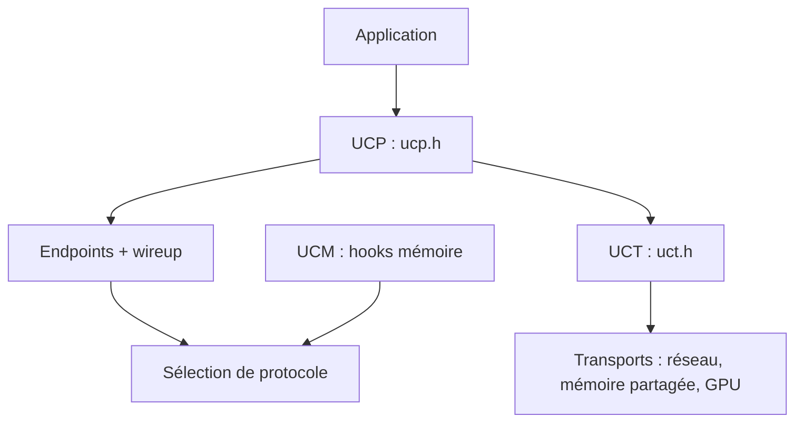

# openucx/ucx

> Communication library for fast networks, used beneath MPI and HPC layers.

## The problem
HPC applications must exploit RDMA, TCP, GPU and shared memory, with a different API for each piece of hardware.

## What it actually does
UCX exposes abstract primitives (tag-matching, streams, active messages, remote memory access, atomics) and chooses the available resources: RDMA (InfiniBand, RoCE), TCP, GPU, shared memory. Four components: UCP (protocols), UCT (low-level transports), UCS (services) and UCM (memory hooks for the registration cache). A performance test tool, ucx_perftest, is provided.

## How it is wired


## Trying it
```bash
./autogen.sh
./contrib/configure-release --prefix=/where/to/install
make -j8
make install
./src/tools/perf/ucx_perftest -c 0
```

## Cost and gotchas
Free. Hardware support (InfiniBand, GPU) depends on configure options. Development builds slow execution down heavily. The README lists known bugs (UCX 1.8.0 with TCP and shared memory, glibc 2.25 to 2.29, rdma-core v22).

## What it is not
Not an application nor a higher-level API: it is the network layer beneath MPI or OpenSHMEM. Contributions require a contributor agreement.

## Alternatives
No alternative cited in the README.

## For you
Worth watching: useful only if you tune communication on a GPU or MPI cluster; otherwise you run into it without handling it.
