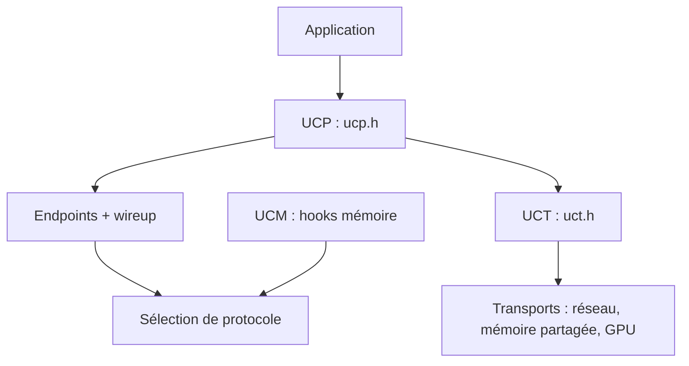

# openucx/ucx

> Bibliothèque de communication pour réseaux rapides, utilisée sous les couches MPI et HPC.

## Le problème
Les applications HPC doivent exploiter RDMA, TCP, GPU et mémoire partagée, avec une API différente pour chaque matériel.

## Ce que ça fait vraiment
UCX expose des primitives abstraites (tag-matching, flux, messages actifs, accès mémoire distant, atomiques) et choisit les ressources disponibles : RDMA (InfiniBand, RoCE), TCP, GPU, mémoire partagée. Quatre composants : UCP (protocoles), UCT (transports bas niveau), UCS (services) et UCM (hooks mémoire pour le cache d'enregistrement). Un outil de test de performance, ucx_perftest, est fourni.

## Comment c'est branché


## Essayer
```bash
./autogen.sh
./contrib/configure-release --prefix=/where/to/install
make -j8
make install
./src/tools/perf/ucx_perftest -c 0
```

## Coût et pièges
Gratuit. Le matériel (InfiniBand, GPU) dépend des options de configure. Les builds de développement ralentissent fortement l'exécution. Le README liste des bugs connus (UCX 1.8.0 avec TCP et mémoire partagée, glibc 2.25 à 2.29, rdma-core v22).

## Ce que ce n'est pas
Pas une application ni une API de plus haut niveau : c'est la couche réseau sous MPI ou OpenSHMEM. Les contributions exigent un accord de contributeur.

## Alternatives
Aucune alternative citée dans le README.

## Pour toi
À surveiller : utile seulement si tu règles la communication d'un cluster GPU ou MPI ; sinon tu la rencontres sans la manipuler.

