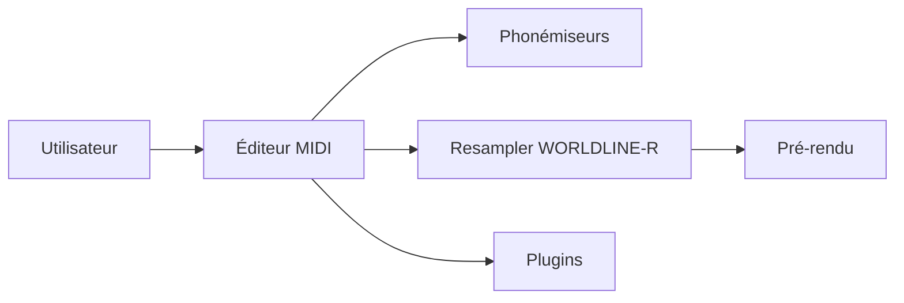

# openutau/OpenUtau

> Free editor for the UTAU community (same README as stakira/OpenUtau, no diagram provided).

## The problem
Compose UTAU singing voices without the limits of the original tool.

## What it actually does
MIDI editor, vibrato editor, multilingual phonemizers (VCV, CVVC, Arpasing), WORLDLINE-R resampler, pre-rendering, VSQX import, ENUNU AI singers, plugin system. Windows, macOS, Linux. No architecture based on the code is provided for this repository.

## How it is wired

(Diagram inferred from the README alone: no graph provided.)

## Trying it
No command documented in the README: read the Getting-Started wiki.

## Cost and gotchas
Free. Possible duplicate of stakira/OpenUtau: same README, created the same day (2014-11-27), 4,460 stars against 4,482.

## What it is not
Neither a digital audio workstation, nor Vocaloid-compatible except for limited features.

## Alternatives
No alternative named in the README.

## For you
Ignore: apparent duplicate of stakira/OpenUtau, domain far from data/AI.
