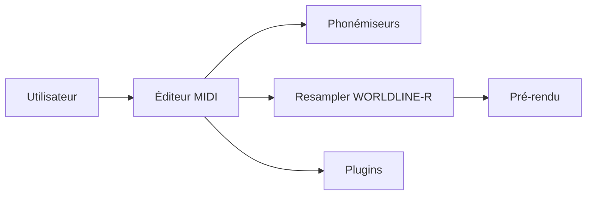

# openutau/OpenUtau

> Éditeur libre pour la communauté UTAU (même README que stakira/OpenUtau, sans schéma fourni).

## Le problème
Composer des voix chantées UTAU sans les limites de l'outil d'origine.

## Ce que ça fait vraiment
Éditeur MIDI, éditeur de vibrato, phonémiseurs multilingues (VCV, CVVC, Arpasing), rééchantillonneur WORLDLINE-R, pré-rendu, import VSQX, chanteurs IA ENUNU, système de plugins. Windows, macOS, Linux. Aucune architecture d'après le code n'est fournie pour ce dépôt.

## Comment c'est branché

(Schéma déduit du seul README : pas de graphe fourni.)

## Essayer
Aucune commande documentée dans le README : lire le wiki Getting-Started.

## Coût et pièges
Gratuit. Possible doublon de stakira/OpenUtau : même README, créé le même jour (2014-11-27), 4 460 étoiles contre 4 482.

## Ce que ce n'est pas
Ni une station audionumérique, ni compatible Vocaloid sauf fonctions limitées.

## Alternatives
Aucune alternative nommée dans le README.

## Pour toi
À ignorer : doublon apparent de stakira/OpenUtau, domaine éloigné de data/IA.

