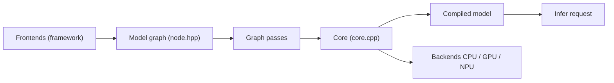

# openvinotoolkit/openvino

> Intel toolkit to convert, optimize and deploy models on CPU, GPU and NPU.

## The problem
A model trained in PyTorch or TensorFlow runs slowly outside its target hardware.

## What it actually does
Converts PyTorch, TensorFlow, ONNX, TFLite, PaddlePaddle and JAX models into an internal representation, then a Core compiles them for a device (x86/ARM CPU, Intel GPU, Intel NPU) and runs inference. Python, C++, C and Node.js APIs; GenAI API for LLMs. Ecosystem: NNCF (quantization), Model Server, Optimum Intel, integrations with vLLM, ONNX Runtime, LangChain.

## How it is wired


## Trying it
```bash
pip install -U openvino
```
```python
import openvino as ov
ov_model = ov.convert_model(model, example_input=(example,))
compiled_model = ov.Core().compile_model(ov_model, 'CPU')
```

## Cost and gotchas
Free. Telemetry is enabled by default (Google Analytics 4); to disable: `opt_in_out --opt_out`.

## What it is not
Optimized for Intel hardware; gains on other hardware are not documented. Not a training framework.

## Alternatives
- ONNX Runtime: OpenVINO plugs into it as a backend (Execution Provider).

## For you
Adopt it to speed up inference on Intel CPU or NPU: it does the job; disable telemetry in production.
