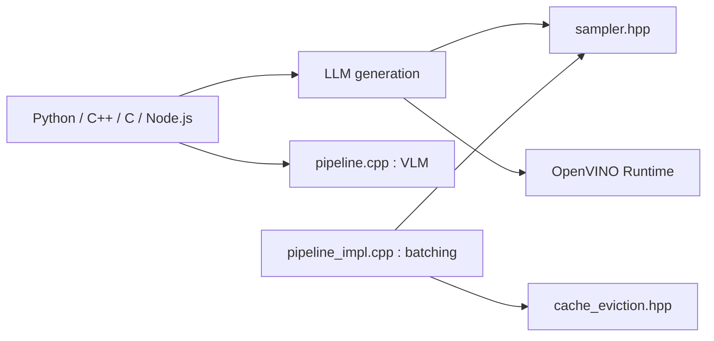

# openvinotoolkit/openvino.genai

> Library of generative AI pipelines optimized on OpenVINO, for PCs and laptops.

## The problem
Running generative models efficiently on Intel CPUs, GPUs or NPUs requires custom integration work.

## What it actually does
LLM, vision-language, image, video, embedding, reranking, speech recognition and speech generation pipelines. Optimizations: continuous batching, KV cache, speculative decoding, sparse attention. Python, C++, C and Node.js APIs, tokenization included.

## How it is wired


## Trying it
```bash
pip install openvino-genai
optimum-cli export openvino --model TinyLlama/TinyLlama-1.1B-Chat-v1.0 --weight-format int4 --trust-remote-code TinyLlama_1_1b_v1_ov
```
```python
import openvino_genai as ov_genai
pipe = ov_genai.LLMPipeline("TinyLlama_1_1b_v1_ov", "CPU")
print(pipe.generate("What is OpenVINO?", max_new_tokens=100))
```

## Cost and gotchas
Free. The model must be converted to the OpenVINO format, with optimum-cli. 247 open issues. Some of the diagram's links are unverified.

## What it is not
It is not a ready-to-use inference server. It is not meant for training models.

## Alternatives
No alternative named in the README.

## For you
Adopt: if you serve models locally on Intel hardware (CPU, GPU, NPU), this is a direct and actively maintained route.
