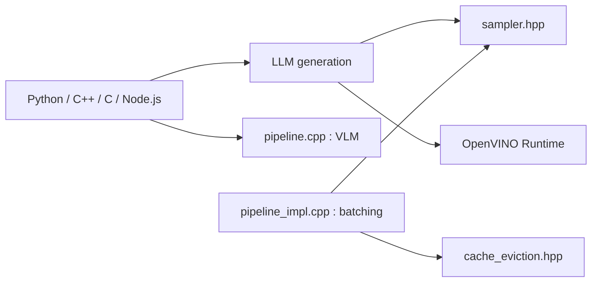

# openvinotoolkit/openvino.genai

> Bibliothèque de pipelines d'IA générative optimisés sur OpenVINO, pour PC et portables.

## Le problème
Faire tourner des modèles génératifs efficacement sur CPU, GPU ou NPU Intel demande de l'intégration sur mesure.

## Ce que ça fait vraiment
Pipelines LLM, vision-langage, images, vidéo, embeddings, reranking, reconnaissance et génération vocale. Optimisations : batching continu, cache KV, décodage spéculatif, attention parcimonieuse. APIs Python, C++, C et Node.js, tokenisation incluse.

## Comment c'est branché


## Essayer
```bash
pip install openvino-genai
optimum-cli export openvino --model TinyLlama/TinyLlama-1.1B-Chat-v1.0 --weight-format int4 --trust-remote-code TinyLlama_1_1b_v1_ov
```
```python
import openvino_genai as ov_genai
pipe = ov_genai.LLMPipeline("TinyLlama_1_1b_v1_ov", "CPU")
print(pipe.generate("What is OpenVINO?", max_new_tokens=100))
```

## Coût et pièges
Gratuit. Le modèle doit être converti au format OpenVINO, avec optimum-cli. 247 issues ouvertes. Les liens du diagramme sont en partie non vérifiés.

## Ce que ce n'est pas
Ce n'est pas un serveur d'inférence prêt à l'emploi. Il ne sert pas à entraîner des modèles.

## Alternatives
Aucune alternative nommée dans le README.

## Pour toi
À adopter : si tu sers des modèles sur matériel Intel (CPU, GPU, NPU) en local, c'est une voie directe et activement maintenue.

