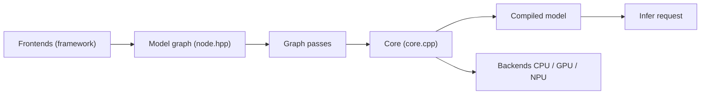

# openvinotoolkit/openvino

> Boîte à outils Intel pour convertir, optimiser et déployer des modèles sur CPU, GPU et NPU.

## Le problème
Un modèle entraîné dans PyTorch ou TensorFlow tourne lentement hors du matériel cible.

## Ce que ça fait vraiment
Convertit des modèles PyTorch, TensorFlow, ONNX, TFLite, PaddlePaddle, JAX en représentation interne, puis un Core les compile pour un appareil (CPU x86/ARM, GPU Intel, NPU Intel) et exécute l'inférence. API Python, C++, C, Node.js ; API GenAI pour LLM. Écosystème : NNCF (quantification), Model Server, Optimum Intel, intégrations vLLM, ONNX Runtime, LangChain.

## Comment c'est branché


## Essayer
```bash
pip install -U openvino
```
```python
import openvino as ov
ov_model = ov.convert_model(model, example_input=(example,))
compiled_model = ov.Core().compile_model(ov_model, 'CPU')
```

## Coût et pièges
Gratuit. Télémétrie activée par défaut (Google Analytics 4) ; désactivation : `opt_in_out --opt_out`.

## Ce que ce n'est pas
Optimisé pour le matériel Intel ; les gains sur autre matériel ne sont pas documentés. Pas un framework d'entraînement.

## Alternatives
- ONNX Runtime : OpenVINO s'y branche comme backend (Execution Provider).

## Pour toi
À adopter pour accélérer l'inférence sur CPU ou NPU Intel : il fait le travail ; désactive la télémétrie en production.

