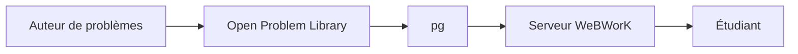

# openwebwork/pg

> Problem engine of WeBWorK, an online homework system for math and science teachers.

## The problem
Grading math homework by hand at scale is slow. You need parameterizable problem statements and automatic grading.

## What it actually does
The README only describes WeBWorK: an online homework system, backed by the MAA and the NSF, with a library of more than 30,000 problems. The exact role of this repository (problem rendering engine) is not detailed: undocumented. The README mostly points to the wiki, the forum and the FAQ.

## How it is wired
Simplified diagram based on the sheet, no diagram provided.



## Trying it
```bash
# Aucune commande documentée dans le README : il renvoie au wiki (First Time Setup).
```

## Cost and gotchas
Free. You must set up your own WeBWorK server by following the wiki. The license is present but not identified by GitHub.

## What it is not
It is neither a data science tool nor a standalone application: it is a component of an educational platform. The README does not explain installation.

## Alternatives
No alternative named in the README.

## For you
Ignore: math teaching tool unrelated to data/AI/MLOps work.
