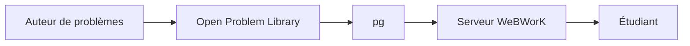

# openwebwork/pg

> Moteur de problèmes de WeBWorK, système de devoirs en ligne de maths et sciences pour enseignants.

## Le problème
Corriger à la main des devoirs de maths à grande échelle est long. Il faut des énoncés paramétrables et une correction automatique.

## Ce que ça fait vraiment
Le README ne décrit que WeBWorK : un système de devoirs en ligne, soutenu par la MAA et la NSF, avec une bibliothèque de plus de 30 000 problèmes. Le rôle exact de ce dépôt (moteur de rendu des problèmes) n'est pas détaillé : non documenté. Le README renvoie surtout vers le wiki, le forum et la FAQ.

## Comment c'est branché
Schéma simplifié d'après la fiche, sans diagramme fourni.



## Essayer
```bash
# Aucune commande documentée dans le README : il renvoie au wiki (First Time Setup).
```

## Coût et pièges
Gratuit. Il faut monter son propre serveur WeBWorK en suivant le wiki. La licence est présente mais non identifiée par GitHub.

## Ce que ce n'est pas
Ce n'est ni un outil de data science ni une application autonome : c'est un composant d'une plateforme pédagogique. Le README n'explique pas l'installation.

## Alternatives
Aucune alternative nommée dans le README.

## Pour toi
À ignorer : outil d'enseignement des maths sans lien avec le travail data/IA/MLOps.

