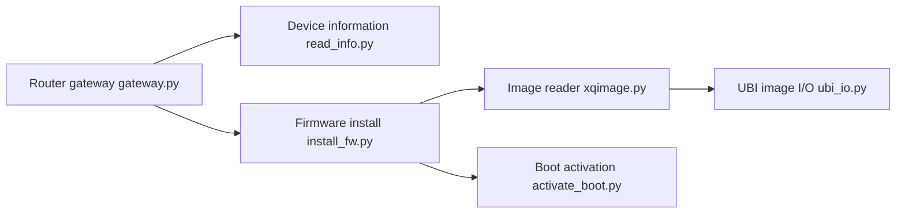

# openwrt-xiaomi/xmir-patcher

> Python tool that modifies Xiaomi router firmware, for those who want to take back control of their router.

## The problem
Xiaomi routers are closed; the README does not detail the precise need. The exact purpose is undocumented.

## What it actually does
The README is a few lines long: "Firmware patcher for Xiaomi routers". From the code, the repository contains modules for router access (gateway, info reading, telnet), firmware installation, boot activation, feature unlocking, SSH and language installation, backup and reboot, plus UBI/UBIFS image and device tree parsers. Wiring between these branches not verified.

## How it is wired


## Trying it
```bash
# Windows
run.bat
# Linux / macOS (Python 3.8+ et openssl requis)
run.sh
```

## Cost and gotchas
Free. Modifying a router's firmware can render it unusable and void the warranty: a backup exists in the code, but nothing is documented. 80 open issues. No license: reuse rights undefined.

## What it is not
Not a firmware, nor OpenWrt: only a modification tool. No usage documentation, compatible models not listed in the README. To be reserved for hardware you own.

## Alternatives
None cited in the README.

## For you
Ignore: this hardware tinkering is outside the data/AI/MLOps scope, and the repository has neither a license nor sufficient documentation.
