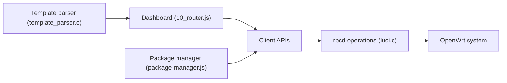

# openwrt/luci

> OpenWrt's web configuration interface, for administering a router from the browser.

## The problem
Configuring an OpenWrt router on the command line is tedious.

## What it is not
Not usable on its own: it assumes a router running OpenWrt.

## What it actually does
JavaScript client views (dashboard, network, firewall, storage, package manager, files) communicating via RPC; server-side operations via ucode and rpcd. C functions (rpcd, reverse DNS, templates, TLS). Translations via Weblate.

## How it is wired


## Trying it
```bash
./scripts/feeds update luci
./scripts/feeds install -a -p luci
```

## Cost and gotchas
Free; integrated into the OpenWrt build system (`src-git luci` feed). Enabled by default.

## Alternatives
None named in the README.

## For you
Ignore: home networking, not data/AI/MLOps.
