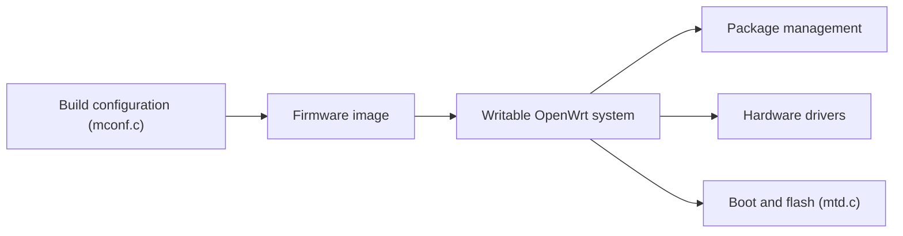

# openwrt/openwrt

> Linux system for embedded devices, mainly routers, with a writable filesystem and package management.

## The problem
Vendor firmwares are frozen; you cannot choose the applications or configure the device freely.

## What it actually does
OpenWrt provides a firmware with a writable filesystem and packages (via `opkg`). You choose the target and packages with `make menuconfig`, then build the kernel, toolchain and applications. Ready-made images are offered through a firmware selector. The code sample in the diagram mostly shows drivers and bootloaders (ADSL modem, AES, MTD, MikroTik, Realtek).

## How it is wired


## Trying it
```bash
./scripts/feeds update -a
./scripts/feeds install -a
make menuconfig
make
```

## Cost and gotchas
Free. Building requires a case-sensitive system (not Cygwin) and many tools. Flashing a router carries a risk of bricking it. 4,692 open issues.

## What it is not
Not a desktop or server distribution. The diagram does not show the build orchestrator, only drivers.

## Alternatives
No alternative named in the README.

## For you
Ignore for data / AI: useful for your router, unrelated to your pipelines.
