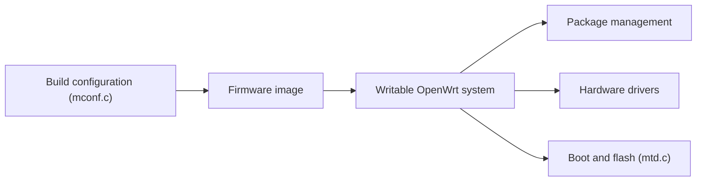

# openwrt/openwrt

> Système Linux pour équipements embarqués, surtout routeurs, avec système de fichiers modifiable et gestion de paquets.

## Le problème
Les firmwares constructeurs sont figés ; on ne peut pas choisir les applications ni configurer l'appareil librement.

## Ce que ça fait vraiment
OpenWrt fournit un firmware avec système de fichiers inscriptible et paquets (via `opkg`). On choisit cible et paquets avec `make menuconfig`, puis on compile le noyau, la chaîne d'outils et les applications. Des images prêtes sont proposées via un sélecteur de firmware. L'exemple de code du diagramme montre surtout des pilotes et chargeurs de démarrage (modem ADSL, AES, MTD, MikroTik, Realtek).

## Comment c'est branché


## Essayer
```bash
./scripts/feeds update -a
./scripts/feeds install -a
make menuconfig
make
```

## Coût et pièges
Gratuit. La compilation demande un système sensible à la casse (pas Cygwin) et beaucoup d'outils. Flasher un routeur comporte un risque de le briquer. 4 692 issues ouvertes.

## Ce que ce n'est pas
Pas une distribution de bureau ni de serveur. Le diagramme ne montre pas l'orchestrateur de build, seulement des pilotes.

## Alternatives
Aucune alternative nommée dans le README.

## Pour toi
À ignorer pour la data / IA : utile pour ton routeur, sans lien avec tes pipelines.

