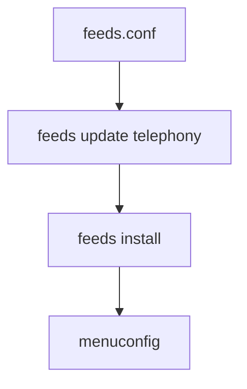

# openwrt/telephony

> Community-maintained OpenWrt package feed for telephony.

## The problem
Adding telephony (SIP, VoIP) to an OpenWrt router requires ready-to-build package definitions.

## What it actually does
A package feed to add to the OpenWrt buildroot. The packages then appear in menuconfig. Their list is not detailed in the README.

## How it is wired


## Trying it
```bash
src-git telephony https://github.com/openwrt/telephony.git
./scripts/feeds update telephony
./scripts/feeds install -a -p telephony
```
The first line goes in `feeds.conf`.

## Cost and gotchas
Free. OpenWrt buildroot required. No license declared at the repository level.

## What it is not
Not an application: a catalog of package definitions.

## Alternatives
No alternative named in the README.

## For you
Ignore: router firmware and telephony, unrelated to data or AI.
