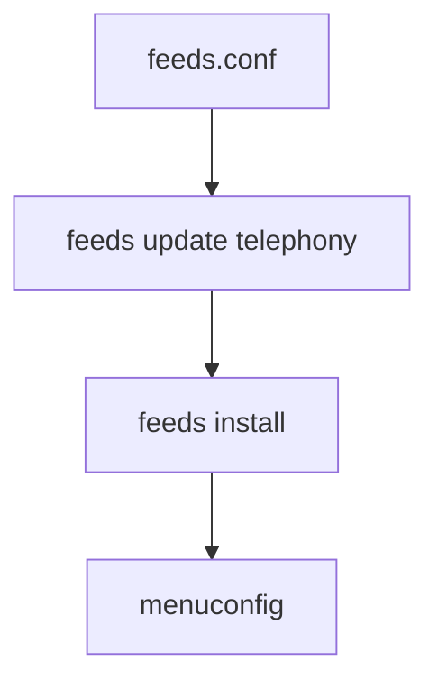

# openwrt/telephony

> Flux de paquets OpenWrt maintenus par la communauté pour la téléphonie.

## Le problème
Ajouter de la téléphonie (SIP, VoIP) à un routeur OpenWrt demande des définitions de paquets prêtes à compiler.

## Ce que ça fait vraiment
Feed de paquets à ajouter au buildroot OpenWrt. Les paquets apparaissent ensuite dans menuconfig. Leur liste n'est pas détaillée dans le README.

## Comment c'est branché


## Essayer
```bash
src-git telephony https://github.com/openwrt/telephony.git
./scripts/feeds update telephony
./scripts/feeds install -a -p telephony
```
La première ligne se place dans `feeds.conf`.

## Coût et pièges
Gratuit. Buildroot OpenWrt requis. Aucune licence déclarée au niveau du dépôt.

## Ce que ce n'est pas
Pas une application : un catalogue de définitions de paquets.

## Alternatives
Aucune alternative nommée dans le README.

## Pour toi
À ignorer : firmware routeur et téléphonie, sans rapport avec la data ou l'IA.

