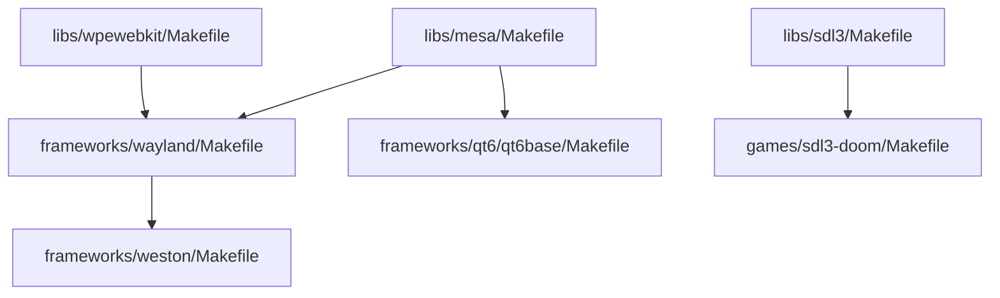

# openwrt/video

> OpenWrt package feed for graphics and video libraries outside the system core.

## The problem
OpenWrt routers and embedded systems do not have graphics packages such as Mesa, Wayland or Qt in their base.

## What it actually does
Collection of package Makefiles: Wayland, Weston, Qt5 and Qt6, Mesa, SDL3, WPE WebKit, Plymouth, kmscon and an SDL3 game. The upper layers depend on Mesa and Wayland. The packages appear in menuconfig, under the Video section.

## How it is wired


## Trying it
```bash
src-git video https://github.com/openwrt/video.git
./scripts/feeds update video
./scripts/feeds install -a -p video
```

## Cost and gotchas
Requires an OpenWrt buildroot and a full compilation. No license declared at the repository level.

## What it is not
Not an application: a feed of package definitions for building a firmware.

## Alternatives
- No alternative named in the README.

## For you
Ignore: embedded and network systems, off-topic for a data / AI / MLOps profile.
