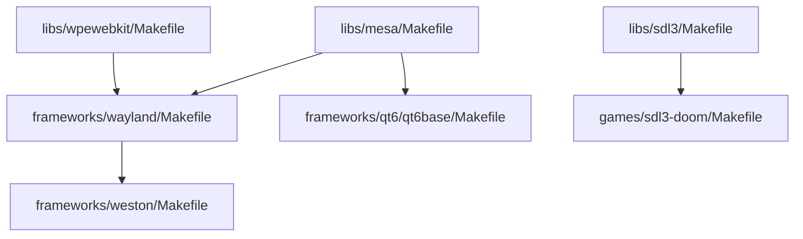

# openwrt/video

> Flux de paquets OpenWrt pour bibliothèques graphiques et vidéo hors du cœur du système.

## Le problème
Les routeurs et systèmes embarqués OpenWrt n'ont pas dans leur base les paquets graphiques comme Mesa, Wayland ou Qt.

## Ce que ça fait vraiment
Collection de Makefile de paquets : Wayland, Weston, Qt5 et Qt6, Mesa, SDL3, WPE WebKit, Plymouth, kmscon et un jeu SDL3. Les couches hautes dépendent de Mesa et de Wayland. Les paquets apparaissent dans menuconfig, section Video.

## Comment c'est branché


## Essayer
```bash
src-git video https://github.com/openwrt/video.git
./scripts/feeds update video
./scripts/feeds install -a -p video
```

## Coût et pièges
Demande un buildroot OpenWrt et une compilation complète. Aucune licence déclarée au niveau du dépôt.

## Ce que ce n'est pas
Pas une application : un flux de définitions de paquets pour construire un firmware.

## Alternatives
- Aucune alternative nommée dans le README.

## Pour toi
Ignorer : de l'embarqué et des systèmes réseau, hors sujet pour un profil data / IA / MLOps.

