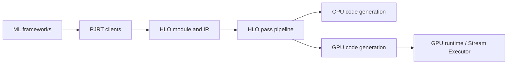

# openxla/xla

> Open source ML compiler for GPUs, CPUs and accelerators, used through PyTorch, TensorFlow and JAX.

## The problem
Running the same model efficiently on different hardware requires a linear algebra operations compiler.

## What it actually does
Receives computations from frameworks, represents them in HLO, applies optimization passes, generates code for CPU (execution engine) or GPU (thunk pipeline, autotuning), then executes. Client interfaces (local, Python, PJRT) and Stream Executor. The README specifies that only contributors and integrators need to clone this repository.

## How it is wired

## Trying it
No command documented in the README: use the framework's documentation (PyTorch, TensorFlow, JAX).

## Cost and gotchas
No need to build it to use it through a framework. Large repository, 1,489 open issues.

## What it is not
Not a library to call directly in a notebook: it is the engine under JAX/TF.

## Alternatives
No alternative named in the README.

## For you
Worth watching: you use it without touching it through JAX; adopt it directly only for compiler work.
